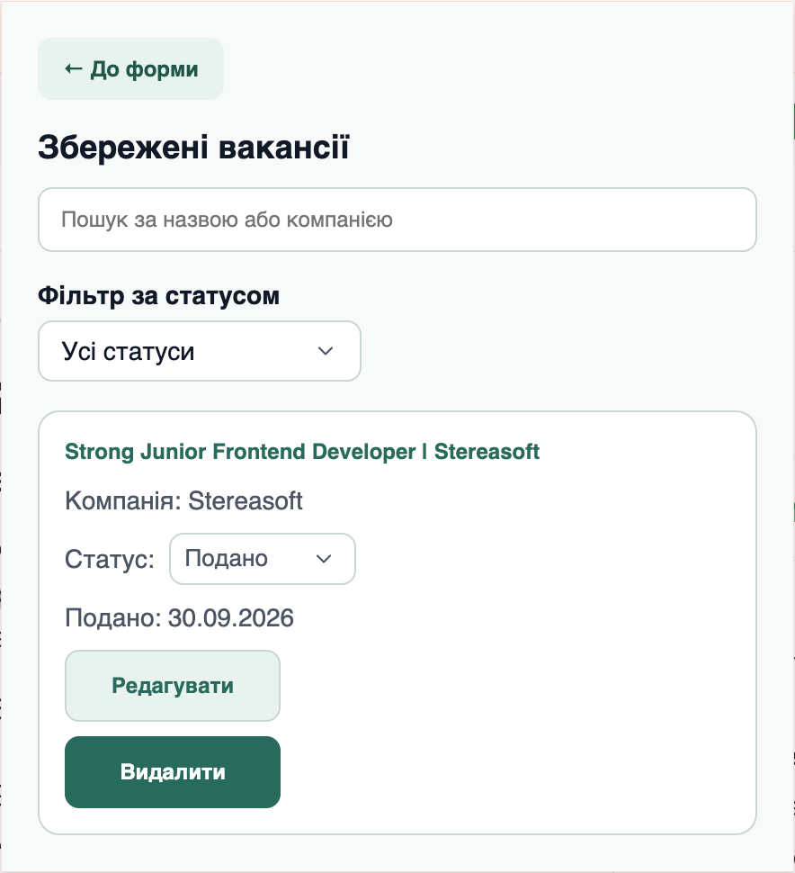
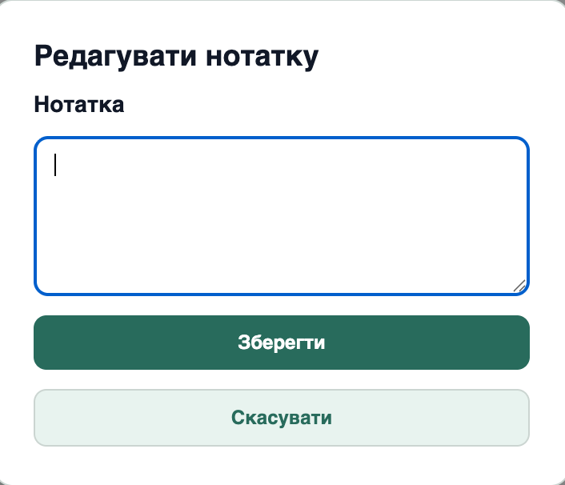

# Job Tracker

[English](README.md) | [Українська](README.uk.md)

A Chrome extension for saving job vacancies directly from the active browser tab and tracking job application progress.

Built with React, TypeScript, Vite, and Chrome Extension Manifest V3.

## Features

- Automatically fills in the job title and URL from the active browser tab.
- Allows users to add a company name and personal notes.
- Saves vacancies locally using `chrome.storage.local`.
- Prevents duplicate vacancies with the same URL.
- Displays saved vacancies with search by job title or company name.
- Filters vacancies by application status, including combined search and filtering.
- Supports four statuses: **Saved**, **Applied**, **Interview**, and **Rejected**.
- Tracks vacancy creation dates and application dates.
- Allows users to set, update, and clear interview dates.
- Supports editing vacancy notes through a modal dialog.
- Allows users to delete saved vacancies.

New vacancies receive the **Saved** status by default. All data is stored locally in the browser.

## Tech Stack

- React
- TypeScript
- Vite
- CSS
- Chrome Extension Manifest V3
- Chrome Storage API
- Oxlint

## Screenshots

### Add a Vacancy


### Saved Vacancies



### Edit Notes



## Installation

Clone the repository and install dependencies:

```bash
git clone https://github.com/TetianaShch/job-tracker
cd job-tracker
npm install
```

Run linting and build the extension:

```bash
npm run lint
npm run build
```

### Load the Extension in Chrome

1. Open `chrome://extensions`.
2. Enable **Developer mode**.
3. Click **Load unpacked**.
4. Select the `dist` folder from the project.

The Job Tracker extension will appear in Chrome. Open a job vacancy page and click the extension icon to save it.

After making changes to the source code, run `npm run build` again and reload the extension on `chrome://extensions`.

## Future Improvements

- Export saved vacancies to CSV.
- Add automated tests.
- Improve error handling for browser storage operations.
